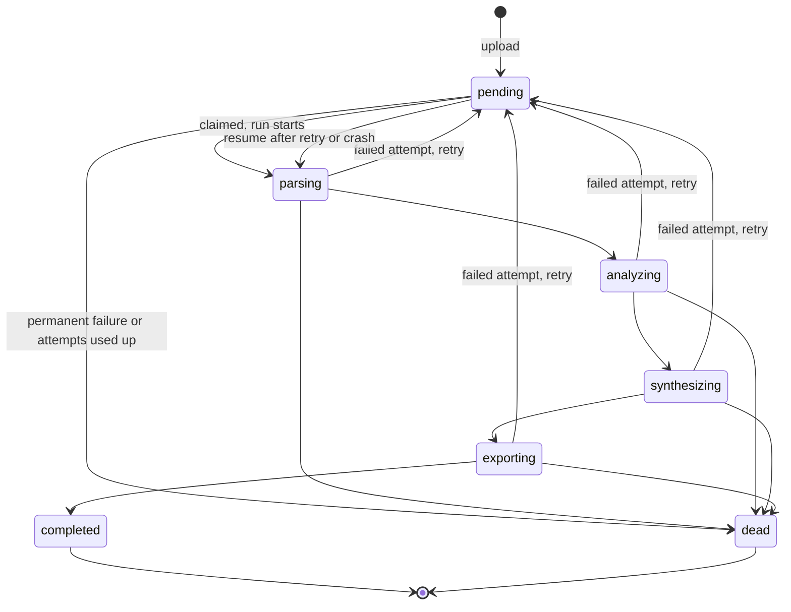
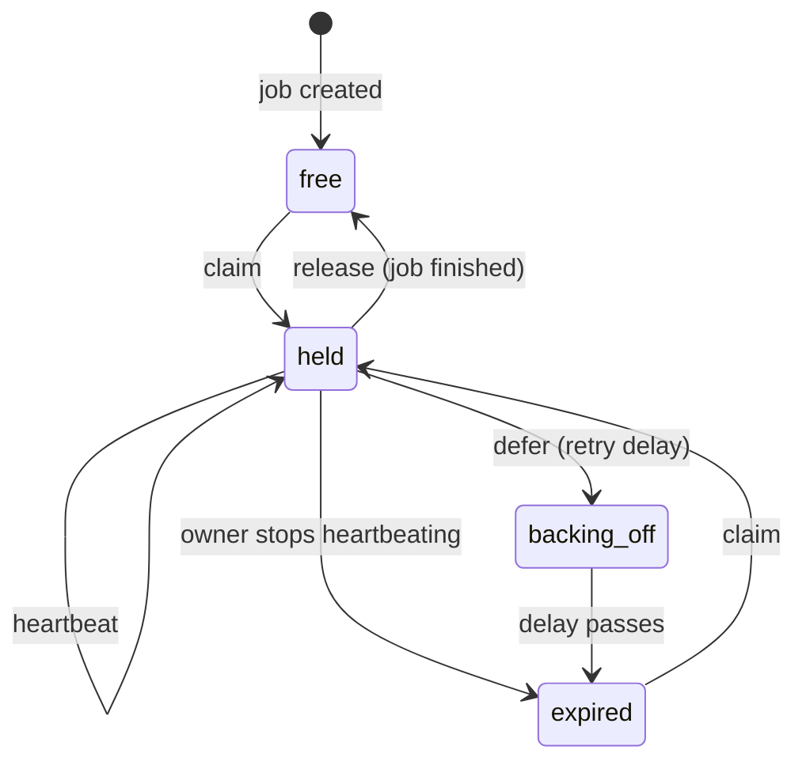
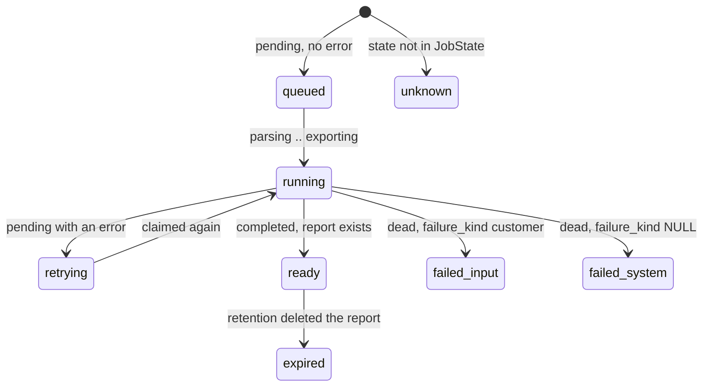
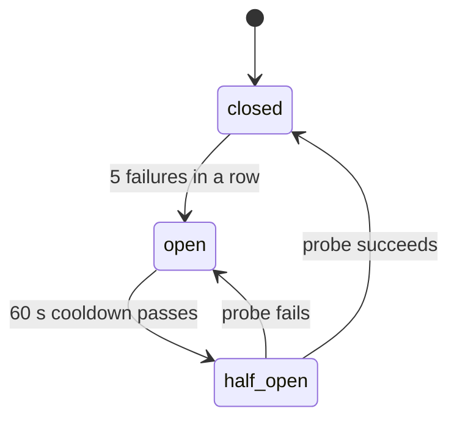

# State machines in Editta

This file lists every place where Editta keeps state, what the states are, how the code
moves between them, and where each rule is enforced. It is a map for people and for agents,
so nobody has to re-read the code to learn the lifecycle. The reasoning behind it is in
[STATE_MACHINES_PLAN.md](STATE_MACHINES_PLAN.md).

**Keeping it current.** When you change a state machine, update its section here in the
same PR. `tests/docs/test_state_machines_doc.py` fails if any `JobState`, `JobPhase` or
`ArtifactKind` value is missing from this file. It cannot check the line numbers, so
re-check those when you move code.

How to read the tables:

- **Where** is `file:line` under `src/editta/` unless the path starts with `infra/`,
  `tests/` or `docs/`.
- **Enforced by** is `DB` (a constraint or a conditional SQL write), `code` (a check in
  Python) or `nothing` (a convention only).

| ID | Machine | Where the state lives |
|---|---|---|
| SM-1 | Job pipeline state | `analysis_jobs.state` |
| SM-2 | Lease and claimability | `lease_owner`, `lease_expires_at`, `attempt` |
| SM-3 | Failure classification | `failure_kind`, `error` |
| SM-4 | User-facing job phase | derived, `domain/job_view.py` |
| SM-5 | Upload form | htmx page state |
| SM-6 | Magic-link token | signed token and `users.last_login_at` |
| SM-7 | Login confirm nonce | `editta_login_nonce` cookie |
| SM-8 | Session | signed cookie |
| SM-9 | User activation and invite | `users` row |
| SM-10 | Credit reservation | ledger rows |
| SM-11 | Stripe purchase | ledger row, Stripe |
| SM-12 | Manuscript lifecycle | `manuscripts.status`, `blob_key` |
| SM-13 | Artifact availability | `reports` rows |
| SM-14 | Circuit breaker | in-memory, `adapters/llm/resilience.py` |
| SM-15 | Token bucket | in-memory |
| SM-16 | Worker process | in-memory |
| SM-17 | OpenRouter retry loop | local variables |
| SM-18 | Rate-limit key | slowapi counters |
| SM-19 | Upload saga | blob store and database |
| SM-20 | Retention purge | blob store and database |
| SM-21 | Batch mode (planned) | not built |

---

## SM-1  Job pipeline state

**States.** `pending`, `parsing`, `analyzing`, `synthesizing`, `exporting`, `completed`,
`dead`. `completed` and `dead` are terminal (`TERMINAL_STATES`, `domain/states.py:24`).
A new job starts `pending` by the column default (`adapters/persistence/tables.py:82`), not
by a transition.

Every state can also go back to `pending` (retry) and to `dead`. `parsing` is also
re-entered from any unfinished state on a resume, for example `analyzing` to `parsing` after
a crash.

**Transitions.** The allowed set is `ALLOWED_FROM` (`domain/states.py:30-38`). The runner
writes states through `_set_state` (`services/jobs.py:215`).

| From | To | Trigger | Where | Guard | Enforced by |
|---|---|---|---|---|---|
| (new) | `pending` | Upload creates the job | `adapters/persistence/repositories.py:158`, `services/uploads.py:87` | none | DB (default) |
| any unfinished | `parsing` | Run starts, or a resume after a retry or a crash | `services/jobs.py:237` | Lease held; from-state in `ALLOWED_FROM` | DB |
| `parsing` | `analyzing` | Source parsed | `services/jobs.py:262` | Same | DB |
| `analyzing` | `synthesizing` | All analysis passes checkpointed | `services/jobs.py:294` | Same | DB |
| `synthesizing` | `exporting` | Synthesis done and checkpointed | `services/jobs.py:307` | Same | DB |
| `exporting` | `completed` | Artifact rows and `completed` commit together | `services/jobs.py:322` | Same; artifact rows roll back if the write fails | DB |
| any unfinished | `pending` | Failed attempt, retryable, attempts left | `services/jobs.py:426` | `decide_after_failure` (`domain/states.py:79`); lease held | DB, code |
| any unfinished | `dead` | Permanent failure, or last attempt failed | `services/jobs.py:441` (via `_dead_letter`) | Same; refund in the same transaction | DB, code |
| any unfinished | `dead` | Claim hands out an attempt past `MAX_ATTEMPTS` | `services/jobs.py:196-201` | `attempts_exhausted` (`domain/states.py:90`) | DB, code |
| `completed`, `dead` | nothing | Never | | `ALLOWED_FROM` has no entry that lists them | DB |

**How a write is fenced.** `set_state_if_owned`
(`adapters/persistence/repositories.py:185-225`) puts the lease and the from-state in one
`WHERE`. If no row matches, one follow-up `SELECT` tells the two cases apart:
`IllegalJobTransition` (the worker holds the lease, the move is forbidden) or `LeaseLost`
(it no longer holds the lease). `IllegalJobTransition` is a subclass of `LeaseLost`
(`domain/errors.py:62-67`), so the runner treats both as "abandon this job"
(`services/jobs.py:204`). Migration `infra/migrations/versions/0010_state_checks.py:35`
adds `ck_job_state`, so no other string can be stored. The retry limits are `MAX_ATTEMPTS = 3`
and a backoff of 60 s, 120 s, 240 s, up to 30 min (`domain/states.py:47-76`).

**What people see.**

- Users: the phase from SM-4, not the raw state.
- Operators: `editta jobs --tenant <id>` (`cli.py:192`) prints phase, raw state, attempt and
  lease. The ops check alerts on dead jobs and on a job that waits too long
  (`worker/ops_check.py:27-43`).
- Agents: `GET /jobs/{job_id}` returns the raw `state` plus `phase`, `terminal`,
  `refunded`, `next_action` and `artifacts` (`api/routes/manuscripts.py:82-105`).

---

## SM-2  Lease and claimability

**States** (derived, `LeaseStatus` in `domain/job_view.py:141`): `free`, `held`,
`backing_off`, `expired`. A terminal job is never claimed, whatever its lease says.

`lease_status` tests "in the past" before "has an owner" (`domain/job_view.py:155`), so a
backed-off job whose delay has passed reads `expired`. Both are claimable.

**Transitions.** The rule is one comparison on `lease_expires_at` (header comment,
`adapters/queue/postgres.py:8-14`).

| From | To | Trigger | Where | Guard | Enforced by |
|---|---|---|---|---|---|
| `free`, `expired` | `held` | Worker claims; `attempt` goes up by 1 | `adapters/queue/postgres.py:124` (SQL `:36-53`) | State not terminal; lease NULL or in the past; `SKIP LOCKED` | DB |
| `held` | `held` | Heartbeat extends the lease | `adapters/queue/postgres.py:149` (SQL `:55-58`) | `lease_owner` matches | DB |
| `held` | `free` | Run ended, no retry | `adapters/queue/postgres.py:162` (SQL `:62-65`) | `lease_owner` matches | DB |
| `held` | `backing_off` | Run ended with a retry delay | `adapters/queue/postgres.py:166` (SQL `:67-70`) | `lease_owner` matches | DB |
| `held` | `expired` | Heartbeat stops (crash, stall) | time passes | none | DB (the claim rule) |
| `backing_off` | `expired` | Delay passes | time passes | none | DB (the claim rule) |

The worker calls these in `worker/main.py:131-181`. Claims go round-robin across tenants
(`adapters/queue/postgres.py:33-53`).

**What people see.**

- Users: nothing directly. A `backing_off` job shows as `retrying` (SM-4).
- Operators: the `lease` column of `editta jobs` (`cli.py:225`). The ops check counts a job
  as waiting when it is not terminal and its lease is free or expired
  (`adapters/queue/postgres.py:77-89`).
- Agents: the same CLI with `--json`.

---

## SM-3  Failure classification

**States.** `failure_kind` is `NULL` ("ours") or `customer` (`CUSTOMER_FAILURE`,
`domain/states.py:42`). `error` is free text that is safe to show to a user.

| From | To | Trigger | Where | Guard | Enforced by |
|---|---|---|---|---|---|
| `NULL` | `customer` | Job dies on a `ParseError` or `BudgetExceeded` | `services/jobs.py:423-424`, `:447` | Terminal failure only | code |
| any | `NULL` | A later state write without an error clears it | `adapters/persistence/repositories.py:209` | Lease held | DB |
| (set) | (set) | A retry writes `error` and keeps `pending` | `services/jobs.py:426-432` | Retryable, attempts left | code |

Only `dead` jobs can carry `customer`: `ck_job_failure_kind`
(`infra/migrations/versions/0010_state_checks.py:42`, mirrored at
`adapters/persistence/tables.py:74-77`).

**What people see.**

- Users: `failed_input` for `customer`, `failed_system` otherwise (SM-4). Both are refunded.
- Operators: the ops check ignores `customer` deaths and counts the others
  (`adapters/queue/postgres.py:77-83`).
- Agents: `phase` and `refunded` in the job status.

---

## SM-4  User-facing job phase

**States** (`JobPhase`, `domain/job_view.py:18-26`): `queued`, `retrying`, `running`,
`ready`, `expired`, `failed_input`, `failed_system`, `unknown`.

The next action (`NextAction`, `domain/job_view.py:29-33`) is `wait`, `download`,
`reupload` or `contact`.

This is a pure function, not a stored state: `job_view()` (`domain/job_view.py:95-119`)
maps `(state, error, failure_kind, artifact kinds)` to a `JobView`.

| Raw state | Other input | Phase | Next action | Terminal | Refunded |
|---|---|---|---|---|---|
| `pending` | no `error` | `queued` | `wait` | no | no |
| `pending` | `error` set | `retrying` | `wait` | no | no |
| `parsing`, `analyzing`, `synthesizing`, `exporting` | | `running` | `wait` | no | no |
| `completed` | a `report` artifact exists | `ready` | `download` | yes | no |
| `completed` | no `report` artifact | `expired` | `reupload` | yes | no |
| `dead` | `failure_kind` is `customer` | `failed_input` | `reupload` | yes | yes |
| `dead` | otherwise | `failed_system` | `contact` | yes | yes |
| any other string | | `unknown` | `contact` | no | no |

An unknown state never raises (`domain/job_view.py:102-105`).

**Who calls it.**

| Reader | Where |
|---|---|
| Dashboard and polling fragment | `api/routes/web.py:357` |
| JSON status | `api/routes/manuscripts.py:93`, fields in `api/schemas.py:64-76` |
| CLI | `cli.py:219` |

**What people see.**

- Users: a label, a hint and a download link only for `ready` (`templates/_job_list.html`).
  The table polls every 3 s while any job is not terminal (`web.py:365`).
- Operators: the same phase in `editta jobs`.
- Agents: poll `GET /jobs/{job_id}` until `terminal`, then act on `next_action`.

---

## SM-5  Upload form

**States.** idle, submitting, accepted, refused, failed.

| From | To | Trigger | Where | Guard | Enforced by |
|---|---|---|---|---|---|
| idle | submitting | Form submit | `templates/dashboard.html:16-26` (`hx-disabled-elt`, `#upload-busy`) | none | code (browser) |
| submitting | accepted | Upload stored, job queued | `api/routes/web.py:343-345`, `templates/_job_list_response.html:4-8` | Valid file, enough credits | code |
| submitting | refused | `ParseError` (422) or `InsufficientCredits` (402) | `api/routes/web.py:335-341`, `_upload_error` at `:76-90` | none | code |
| submitting | failed | 401, 403, 413, 429 or 5xx | `api/main.py:57-75`, `templates/base.html:7-10`, `:30` | none | code |
| refused, failed | idle | Next success clears the old message | `templates/_job_list_response.html:5-6` | none | code |

On success the response clears `#upload-error` and `#htmx-error` and resets the file input
(out-of-band swaps). A 401 sends the user to the sign-in page (see SM-8).

**What people see.**

- Users: a disabled button and "Uploading..." while submitting; a message above the form on
  refusal or failure.
- Operators: request logs carry an `X-Request-ID`.
- Agents: the JSON upload route keeps the real 4xx status.

---

## SM-6  Magic-link token

**States.** issued, checked (valid), spent, expired, invalid. The token is a signed string;
only "spent" is stored, as `users.last_login_at`.

| From | To | Trigger | Where | Guard | Enforced by |
|---|---|---|---|---|---|
| (none) | issued | Sign-in link requested for a known email | `services/accounts.py:143-160`, `:194-196` | Account exists; rate limit `10/minute` | code |
| issued | checked | User opens the link (no sign-in yet) | `api/routes/web.py:153-193`, `services/accounts.py:162-182` | Signature, 900 s age, tenant match, `last_login_at < issued_at` | code |
| checked | spent | User confirms | `api/routes/web.py:196-217`, `adapters/persistence/repositories.py:85-101` | One conditional `UPDATE` | DB |
| issued | spent | JSON API verify | `api/routes/auth.py:62-71` | Same | DB |
| issued | expired | More than 900 s | `services/accounts.py:35`, `:203-204` | none | code |
| issued | invalid | Bad signature, wrong tenant, no account | `services/accounts.py:168-173`, `:205-206` | none | code |

Browser errors render `login.html` with the reason and keep the 401 status
(`web.py:98-108`). The JSON API keeps `{"detail": ...}`.

**What people see.**

- Users: the sign-in page with the reason and a form to ask for a new link.
- Operators: nothing stored besides `last_login_at`.
- Agents: 401 with a `detail` string on `/auth/verify`.

---

## SM-7  Login confirm nonce

**States.** none, set, matched, rejected.

| From | To | Trigger | Where | Guard | Enforced by |
|---|---|---|---|---|---|
| none | set | Link page shown | `api/routes/web.py:178-192` | Link is valid; cookie is `httponly`, `secure`, `samesite=strict`, 15 min | code |
| set | matched | Confirm POST carries the same nonce | `api/routes/web.py:205-206` | `hmac.compare_digest` | code |
| matched | none | Sign-in done, cookie deleted | `api/routes/web.py:239` | none | code |
| none, set | rejected | Missing or different nonce | `api/routes/web.py:206-213` | none | code |

A rejection renders the sign-in page with a 403 and the text "open the sign-in link in this
browser, then confirm".

**What people see.** Users get the message above. Operators and agents see nothing extra.

---

## SM-8  Session

**States.** none, valid, expired, invalid, account no longer active. The session is a signed
cookie valid for 30 days (`services/accounts.py:36`). There is no server-side store.

| From | To | Trigger | Where | Guard | Enforced by |
|---|---|---|---|---|---|
| none | valid | Sign-in confirmed | `api/routes/web.py:219-238`, `services/accounts.py:209-211` | SM-6 and SM-7 passed | code |
| valid | expired | 30 days pass | `services/accounts.py:216-217` | none | code |
| valid | invalid | Signature fails | `services/accounts.py:218-219` | none | code |
| valid | no longer active | User row gone, or email changed | `services/accounts.py:184-189` | none | code |
| valid | none | Sign out (cookies deleted) | `api/routes/web.py:243-260` | CSRF header | code |

A request with no valid session gets a 401 (`api/deps.py:79-88`). On a signed-in page
(`/t/{tenant}/...`) a browser GET gets a 303 to the sign-in page, and an htmx request gets
`HX-Redirect` (`api/main.py:57-75`). The JSON API keeps the 401.

**Shortcut.** Nothing revokes a single session. Removing the user revokes all of that
user's sessions.

**What people see.** Users land on the sign-in page. Agents get 401 JSON.

---

## SM-9  User activation and invite

**States.** invited (`last_login_at IS NULL`), active (`last_login_at` set).

| From | To | Trigger | Where | Guard | Enforced by |
|---|---|---|---|---|---|
| (none) | invited | Admin invite or operator command | `services/accounts.py:119-139`, `adapters/persistence/repositories.py:63-75` | Admin role for invites; `role` in `ROLES` (also `ck_user_role`, `tables.py:38`) | code, DB |
| invited | active | First sign-in confirmed | `adapters/persistence/repositories.py:85-101` | SM-6 | DB |
| invited, active | same | Invite again | `services/accounts.py:136-139` | Existing user is returned as is | code |

A second invite keeps the old role. The response says so: `role_applied` is false when the
requested role was not applied (`api/routes/auth.py:98-116`).

**What people see.** Admins see `role_applied` in the invite response. Operators and users
see nothing else.

---

## SM-10  Credit reservation

**States.** none, reserved, refunded. Each is the existence of a ledger row; the balance is
the sum of `delta` (`adapters/persistence/repositories.py:375`).

| From | To | Trigger | Where | Guard | Enforced by |
|---|---|---|---|---|---|
| none | reserved | Upload, key `job:{id}:reserve` | `services/uploads.py:80-94`, key at `domain/credits.py:19` | Tenant row locked; balance is enough | DB |
| reserved | refunded | Job dies, key `job:{id}:refund` | `services/jobs.py:452-460`, key at `domain/credits.py:25` | Same transaction as `dead`; refunds the reserved amount | DB |

`append_once` is `ON CONFLICT DO NOTHING` on `idempotency_key`
(`adapters/persistence/repositories.py:331-363`), so a replay changes nothing. A `completed`
job keeps its reservation: that is the charge.

**What people see.** Users: the balance on the dashboard and "credit refunded" on failed
jobs. Operators: the `credit_ledger` table.

---

## SM-11  Stripe purchase

**States.** none, credited.

| From | To | Trigger | Where | Guard | Enforced by |
|---|---|---|---|---|---|
| none | credited | Stripe webhook for a paid Checkout Session | `api/routes/billing.py:62-86`, `services/billing.py:80-101` | Signature valid; tenant known; one credit per session; key `stripe-session:{checkout_session_id}` | DB |
| credited | credited | Any later event for the same session | `api/routes/billing.py:74-75`, `:80-86` | `has_purchase` (`adapters/persistence/repositories.py:365`), then the unique key | DB |

**Shortcut.** `has_purchase` only protects rows that were keyed by event id before the key
change. Delete it three days after that deploy (comment at `api/routes/billing.py:72-73`).

Unknown tenants and events without a tenant are acknowledged and ignored
(`billing.py:68-70`, `services/billing.py:94-100`). The success page
(`api/routes/billing.py:90-104`) holds no state and does not poll: it links back to the
dashboard, which shows the balance.

**What people see.** Users: the new balance after the webhook arrives. Operators: Stripe
logs and `billing.*` warnings.

---

## SM-12  Manuscript lifecycle

**States.** `uploaded`, `purged` (`manuscripts.status`).

| From | To | Trigger | Where | Guard | Enforced by |
|---|---|---|---|---|---|
| (none) | `uploaded` | Upload | `adapters/persistence/repositories.py:108`, `services/uploads.py:81` | none | DB (default) |
| `uploaded` | `purged` | Retention sweep | `adapters/persistence/repositories.py:145-151`, `services/retention.py:104` | `retention_until` passed | DB |

`status` and `blob_key` describe one fact: `ck_manuscript_purged_blob` requires
`(status = 'purged') = (blob_key = '')` (`infra/migrations/versions/0010_state_checks.py:49`).
`ck_manuscript_status` limits `status` (`:44`). The runner reads `blob_key`
(`services/jobs.py:241`) and the sweep reads `status` (`repositories.py:137-143`); the
constraint keeps them equal. A job on a purged manuscript dies with a plain `EdittaError`,
so `failure_kind` is `NULL`.

**What people see.** Users see `expired` for finished jobs (SM-4). Operators: nothing
separate.

---

## SM-13  Artifact availability

**States.** An artifact is available when its `reports` row exists. The kinds
(`ArtifactKind`, `domain/artifacts.py:19-21`) are `report` and `annotated_manuscript`.
`report` is the main file; `annotated_manuscript` exists only when its exporter applies to
the job (`services/jobs.py:402`).

| From | To | Trigger | Where | Guard | Enforced by |
|---|---|---|---|---|---|
| none | available | Job reaches `completed` | `services/jobs.py:319-322`, `adapters/persistence/repositories.py:294-305` | Same transaction as `completed`; unique `(job_id, kind)` | DB |
| available | none | Retention purge | `adapters/persistence/repositories.py:320-322`, `services/retention.py:103` | none | DB |

`kind` is limited by `ck_report_kind` (`infra/migrations/versions/0010_state_checks.py:51`).
The download route validates the kind against the enum (`api/routes/web.py:398-425`). A
missing row raises `ReportNotReady`, a `NotFound` (`domain/errors.py:115`,
`services/reports.py:48-50`), which is a 404. The dashboard shows the link only for `ready`.

**What people see.** Users: download links for `ready` jobs only. Agents: `artifacts` in the
job status lists the kinds that can be downloaded.

---

## SM-14  Circuit breaker

**States** (`BreakerState`, `adapters/llm/resilience.py:18-21`): `closed`, `open`,
`half_open`. The state is derived from `_opened_at` and the cooldown
(`resilience.py:35-41`); `_probing` only feeds the logs.

| From | To | Trigger | Where | Guard | Enforced by |
|---|---|---|---|---|---|
| `closed` | `open` | `FAILURE_THRESHOLD` (5) failures in a row; logs `llm.breaker_opened` | `adapters/llm/resilience.py:60-69` | Failures counted only for provider errors, not for request rejections | code |
| `open` | `half_open` | `COOLDOWN_SECONDS` (60) pass | `adapters/llm/resilience.py:39-41` | time | code |
| `half_open` | probe in flight | First call after the cooldown; logs `llm.breaker_probe` | `adapters/llm/resilience.py:43-51` | Only that call runs; others fail until the next cooldown | code |
| `half_open` | `closed` | Probe succeeds; logs `llm.breaker_closed` | `adapters/llm/resilience.py:53-58` | none | code |
| `half_open` | `open` | Probe fails; logs `llm.breaker_opened` | `adapters/llm/resilience.py:60-69` | none | code |

Callers: `adapters/llm/openrouter.py:192-202` and `adapters/llm/client.py:130-159`. There is
one breaker per client, held in memory per worker process. An open breaker makes calls fail
with `LLMError("circuit breaker open ...")` (`resilience.py:47`); the job then retries
after its backoff (SM-1).

**What people see.**

- Users: a `retrying` job with a plain message (SM-4).
- Operators: the three `llm.breaker_*` log events, once per change. Not shared between
  processes.
- Agents: nothing beyond the job's `retrying` phase.

---

## SM-15  Token bucket

**States.** A level between 0 and `capacity`; no named states. `acquire` waits until enough
tokens have refilled (`adapters/llm/resilience.py:82-92`). It holds `capacity` tokens and
refills `rate / 60` per second, set from `llm_requests_per_minute`
(`adapters/llm/openrouter.py:166-168`). `config.py:31` requires `ge=1`, so the refill rate
is never 0 and the wait cannot divide by zero.

**What people see.** Nobody directly; a burst of calls is slowed down.

---

## SM-16  Worker process

**States.** running (claim loop), draining (shutdown requested), drained.

| From | To | Trigger | Where | Guard | Enforced by |
|---|---|---|---|---|---|
| running | draining | SIGTERM or SIGINT | `worker/main.py:96-98`, `:196-205` | none | code |
| draining | drained | The job in hand finishes, loop exits | `worker/main.py:103`, `:116` | none | code |

The heartbeat task lives for one job (`worker/main.py:141-155`, `:183-193`). A failed claim
is logged and the loop polls again (`:104-110`).

**Shortcut.** There is no drain deadline: the worker waits for the current job. An
orchestrator that kills the process earlier leaves the lease to expire (SM-2).

**What people see.** Operators: `worker.shutdown_requested` and `worker.drained` logs.

---

## SM-17  OpenRouter retry loop

**States.** Local to one call: attempt 1 to `MAX_ATTEMPTS` (3, `adapters/llm/openrouter.py:61`),
then success or the last error.

| From | To | Trigger | Where | Guard | Enforced by |
|---|---|---|---|---|---|
| attempt n | attempt n+1 | 408, 409, 429, 5xx, a network error, or an error inside a 200 | `adapters/llm/openrouter.py:210-247` | Delay `2**attempt` s, or `retry-after` | code |
| any | rejected | A status in `_NON_RETRYABLE_STATUSES` | `adapters/llm/openrouter.py:218-224` | No retry; does not count against the breaker | code |
| attempt 3 | failed | Last attempt fails | `adapters/llm/openrouter.py:248` | Counts against the breaker (SM-14) | code |

**Shortcut.** Retries are not logged.

**What people see.** Nobody directly.

---

## SM-18  Rate-limit key

**States.** The counter key is `user:{id}` for a validly signed session cookie, otherwise
`ip:{host}` (`api/middleware.py:49-58`). Limits are `120/minute` by default and `10/minute`
for sign-in link requests (`middleware.py:61-79`).

| From | To | Trigger | Where | Guard | Enforced by |
|---|---|---|---|---|---|
| `ip:` key | `user:` key | A valid session cookie arrives | `api/middleware.py:53-57` | Signature check only; a made-up cookie keeps the IP key | code |
| counting in process | counting in shared store | `rate_limit_storage_uri` is set | `api/middleware.py:61-74` | none | code |
| shared store | limits skipped | The store is unreachable | `api/middleware.py:70` | `swallow_errors` | code |

With no storage URI, each API process counts on its own, so the real limit is higher by the
number of processes.

**What people see.** A 429 on the JSON API; on signed-in pages the alert region (SM-5).

---

## SM-19  Upload saga

**States.** blob stored, rows written, committed, cleaned up, orphaned.

| From | To | Trigger | Where | Guard | Enforced by |
|---|---|---|---|---|---|
| start | blob stored | File passes validation | `services/uploads.py:70-76` | `validate_upload` | code |
| blob stored | rows written | Tenant locked, credits checked, rows and reservation inserted | `services/uploads.py:77-97` | Balance covers the cost | DB (lock), code |
| rows written | committed | The caller's transaction commits | `api/deps.py:91-101` | none | DB |
| blob stored | cleaned up | Any error before the commit | `services/uploads.py:98-106` | `delete_prefix` works | code |
| blob stored | orphaned | Cleanup fails, or the commit fails | `services/uploads.py:103-105`, `:107-108` | Logs `upload.orphan_blob` with the key; the original error is re-raised | nothing |

**Shortcut.** An orphaned blob has no row, so retention never deletes it. Add an orphan
sweep if the log line ever appears.

**What people see.** Users: the refusal or failure from SM-5. Operators: the
`upload.orphan_blob` log.

---

## SM-20  Retention purge

**States.** A manuscript is live, expired (past `retention_until`) or purged (SM-12).

| From | To | Trigger | Where | Guard | Enforced by |
|---|---|---|---|---|---|
| live | expired | Time passes | `adapters/persistence/repositories.py:137-143` | `retention_until < now`, `status != purged` | DB (query) |
| expired | purged | Sweep: delete blobs, then rows, then mark purged | `services/retention.py:84-104` | Blobs first, so a failure leaves work for the next run; each manuscript is independent | code |

The sweep is run by cron through `worker/retention.py:53-76` and exits 1 if any manuscript
failed. It deletes the source, the checkpoints, the artifacts and their rows. The manuscript
row and its jobs stay. A purged job stays `completed`, so SM-4 shows it as `expired`.

**What people see.** Users: `expired` with a hint to upload again. Operators: the
`retention.swept` log and the sweep's exit code.

---

## SM-21  Batch mode (planned)

Not built. Design it in `docs/FEATURES_PLAN.md` §3.2 (line 237) together with item 9 of
`docs/STATE_MACHINES_PLAN.md`: add the new state to `ALLOWED_FROM`, to `ck_job_state` (a new
migration) and to `JobPhase` in one PR, and do not encode a state inside an id column. Add
its section here when it ships.
